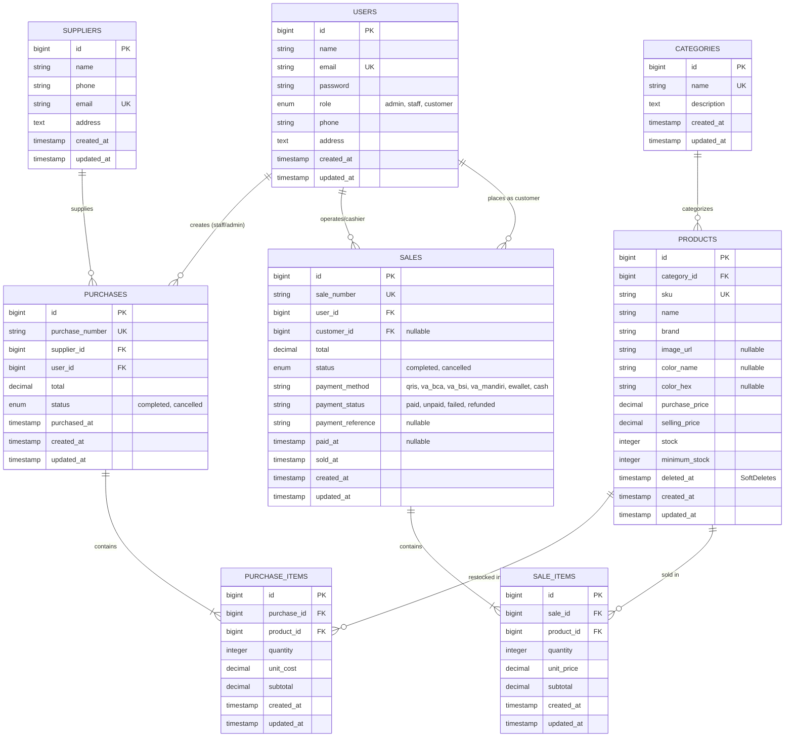

# ElectroMart - Inventory & Sales Management System

[](https://laravel.com)
[](https://www.php.net)
[](https://www.apachefriends.org)
[](https://phpunit.de)
[](LICENSE)

Proyek Ujian Tengah Semester (UTS) Mata Kuliah **Pemrograman Web**.  
Aplikasi sistem informasi pengelolaan persediaan barang (inventaris) dan transaksi penjualan terintegrasi bertema **Toko & Distribusi Perangkat Elektronik** (*ElectroMart*), dibangun menggunakan arsitektur modern **Laravel 12**, **MySQL (XAMPP)**, dan **Bootstrap 5**.

---

## Daftar Isi (Deliverables UTS - Slide 20 PPT)

1. [Project Overview](#1-project-overview)
2. [Requirements](#2-requirements)
3. [Installation (Langkah demi Langkah)](#3-installation-langkah-demi-langkah)
4. [Environment Setup](#4-environment-setup)
5. [Migration & Seeding](#5-migration--seeding)
6. [Demo Account](#6-demo-account)
7. [Features & Business Rules](#7-features--business-rules)
8. [Entity Relationship Diagram (ERD) & Penjelasan Relasi](#8-entity-relationship-diagram-erd--penjelasan-relasi)
9. [Screenshots Halaman Utama dan Transaksi](#9-screenshots-halaman-utama-dan-transaksi)
10. [Test Cases dan Bukti Hasil Pengujian](#10-test-cases-dan-bukti-hasil-pengujian)
11. [Known Limitations](#11-known-limitations)

---

## 1. Project Overview

**ElectroMart** adalah sistem informasi manajemen inventaris dan transaksi penjualan ritel/distribusi elektronik yang dirancang untuk mengotomatisasi operasional toko secara menyeluruh. Sistem ini mengintegrasikan rantai pasok mulai dari pengadaan barang masuk (*stock-in*) dari pemasok resmi, pencatatan kasir Point of Sales (*POS*), hingga modul e-commerce mandiri (*self-service checkout*) untuk pelanggan dengan gerbang pembayaran digital interaktif **ElectroPay (Midtrans Snap)**.

### Arsitektur & Teknologi:
- **Framework Utama**: Laravel 12.x (arsitektur MVC & Service Layer)
- **Bahasa Pemrograman**: PHP ^8.2 (Type hinting, constructor property promotion, match expressions)
- **Database Engine**: MySQL 8.0+ / MariaDB 10.4+ (InnoDB engine dengan transaksi ACID)
- **Frontend & Styling**: Blade Templating Engine, Bootstrap 5.3, Bootstrap Icons
- **Pengujian Otomatis**: PHPUnit / Pest Test Framework (69 automated feature tests)

---

## 2. Requirements

Pastikan perangkat komputer Anda telah memenuhi spesifikasi berikut sebelum menjalankan aplikasi:

- **PHP**: Versi `^8.2` atau lebih tinggi (ekstensi aktif: `pdo_mysql`, `mbstring`, `openssl`, `tokenizer`, `xml`, `ctype`, `json`, `bcmath`).
- **Composer**: Versi `^2.2` atau lebih tinggi untuk manajemen dependensi PHP.
- **MySQL / MariaDB**: MySQL 8.0+ atau MariaDB 10.4+ (disediakan oleh paket **XAMPP**).
- **Web Server**: Apache XAMPP atau PHP Built-in Server (`php artisan serve`).
- **Browser Modern**: Google Chrome, Mozilla Firefox, Microsoft Edge, atau Safari dengan dukungan JavaScript aktif.

---

## 3. Installation (Langkah demi Langkah)

Ikuti langkah-langkah instalasi berikut secara berurutan:

### 1. Clone Repository
Buka terminal (Git Bash / PowerShell), arahkan ke direktori web server (misalnya `C:/xampp/htdocs/`):
```bash
git clone https://github.com/tarimurni/tarimurni-UTS_Integrated_Project_Laravel.git
cd tarimurni-UTS_Integrated_Project_Laravel
```

### 2. Install Dependensi PHP
Jalankan Composer untuk mengunduh seluruh dependensi Laravel 12:
```bash
composer install
```

### 3. Salin Environment File
Salin file konfigurasi `.env.example` menjadi `.env`:
```bash
cp .env.example .env
```

### 4. Generate Application Key
Buat kunci enkripsi aplikasi:
```bash
php artisan key:generate
```

### 5. Jalankan Server Lokal
Nyalakan server pengembangan lokal Laravel:
```bash
php artisan serve
```
Akses aplikasi melalui browser pada alamat: **[http://localhost:8000](http://localhost:8000)**

---

## 4. Environment Setup

Pastikan modul **Apache** dan **MySQL** pada **XAMPP Control Panel** telah aktif.

### Konfigurasi Database pada File `.env`:
Buka file `.env` dan sesuaikan parameter koneksi database lokal Anda:
```env
APP_NAME="ElectroMart Inventory & Sales"
APP_ENV=local
APP_KEY=base64:...
APP_DEBUG=true
APP_TIMEZONE=Asia/Jakarta
APP_URL=http://localhost:8000

DB_CONNECTION=mysql
DB_HOST=127.0.0.1
DB_PORT=3306
DB_DATABASE=db_uts_elektronik
DB_USERNAME=root
DB_PASSWORD=
```

### Pembuatan Database MySQL:
Buka **phpMyAdmin** (`http://localhost/phpmyadmin`) atau jalankan perintah SQL berikut di terminal:
```sql
CREATE DATABASE IF NOT EXISTS db_uts_elektronik CHARACTER SET utf8mb4 COLLATE utf8mb4_unicode_ci;
```

---

## 5. Migration & Seeding

Jalankan perintah migrasi tabel dan seeding data awal dummy:
```bash
php artisan migrate:fresh --seed
```

Perintah ini akan membuat struktur tabel relasional berikut dan mengisinya dengan data seed:
- `users`: Akun administrator, staff kasir, dan pelanggan.
- `categories`: Kategori perangkat elektronik (Laptop, Smartphone, Audio, Aksesoris, Perangkat Cerdas).
- `suppliers`: Data distributor resmi pemasok elektronik.
- `products`: 15 produk elektronik realistis (lengkap dengan 4 produk berkondisi *low-stock* untuk verifikasi alert).
- `purchases` & `purchase_items`: Riwayat transaksi pengadaan stok masuk.
- `sales` & `sale_items`: Riwayat transaksi penjualan, nomor referensi payment gateway, dan rincian item.

*(Opsional) Bersihkan cache view yang terkompilasi:*
```bash
php artisan view:clear
```

---

## 6. Demo Account

Aplikasi menyediakan akun default dengan hak akses bertingkat (*Role-Based Access Control*). Sesuai dengan standar keamanan sistem produksi dan ketentuan **Slide 20 PPT UTS**, seluruh kredensial akun demo **hanya dicantumkan di dokumentasi README.md ini** dan **tidak dibocorkan / tidak ditampilkan pada antarmuka halaman login**:

| Role | Nama Pengguna | Email Login | Password | Hak Akses & URL Utama |
| :--- | :--- | :--- | :--- | :--- |
| 👑 **Admin Owner** | **Salsa Callista** | `admin@electromart.test` | `admin123` | Akses penuh: `/dashboard`, `/products`, `/categories`, `/suppliers`, `/users`, `/purchases`, `/sales` |
| 💼 **Staff Kasir/Gudang** | **Ade Afrina** | `staff@electromart.test` | `staff123` | Kasir POS & Gudang: `/dashboard`, `/sales/create`, `/purchases/create`, `/products` (HTTP 403 mutasi master data) |
| 🛍️ **Customer Demo** | **Customer Demo** | `customer@electromart.test` | `customer123` | Pelanggan Toko: `/catalog`, `/customer/orders` (Katalog Mandiri & Checkout) |
| 🛍️ **Customer 1** | **Rahmania** | `rahmania@customer.local` | `customer123` | Pelanggan Toko: `/catalog`, `/customer/orders` (Katalog Mandiri & Checkout) |
| 🛍️ **Customer 2** | **Alfi Syahri** | `alfisyahri@customer.local` | `customer123` | Pelanggan Toko: `/catalog`, `/customer/orders` (Katalog Mandiri & Checkout) |

> [!NOTE]
> **Peningkatan Keamanan Autentikasi (Sesuai Syarat Slide 20 PPT Dosen):**
> 1. **Pemisahan Kata Sandi Antar-Peran**: Setiap role memiliki kata sandi berbeda (`admin123`, `staff123`, `customer123`) sehingga mencegah eskalasi hak akses antar role (Staff tidak dapat login ke akun Admin).
> 2. **Pembersihan Bocoran Kredensial**: Seluruh tombol *1-klik auto-login* dan teks bocoran password pada form login (`/login` & `/portal/login`) telah dihapus secara total layaknya sistem produksi nyata.

---

## 7. Features & Business Rules

### 1. Pembaruan Stok Otomatis & Atomik (ACID):
- Transaksi **Pembelian (Stock-In)** dari supplier resmi otomatis menambah nilai `stock` produk.
- Transaksi **Penjualan (Stock-Out)** via kasir POS maupun checkout customer otomatis memotong nilai `stock` produk.
- Menggunakan `DB::transaction` dan *pessimistic locking* (`Product::lockForUpdate()`) guna menjamin konsistensi ACID (*Atomicity, Consistency, Isolation, Durability*) serta mencegah *race condition* dan *overselling*.

### 2. Integrasi Payment Gateway (ElectroPay powered by Midtrans Snap):
- Mendukung kanal pembayaran digital multi-channel:
  - **QRIS Instant (Scan QR)**: Standar Nasional QRIS yang kompatibel dengan seluruh Mobile Banking (BCA, Mandiri, BRI, BSI) & E-Wallet (GoPay, OVO, DANA, ShopeePay) dengan identitas merchant resmi *"ELECTROMART OFFICIAL STORE"*.
  - **Bank Virtual Account (VA)**: Nomor VA 16 digit terformat otomatis untuk Bank BCA (`80777...`), Bank BSI Syariah (`90012...`), dan Bank Mandiri (`88901...`) disertai tombol *1-klik Salin Nomor VA* dan panduan transfer ATM/m-Banking.
  - **E-Wallet Instant**: Simulasi push notification pembayaran via dompet digital.
  - **Tunai / Cash di Toko**: Pembayaran kasir tunai offline di meja counter.
- Layar pembayaran interaktif (`/sales/{sale}/payment`) dan Popup Modal `#snapModal` dengan countdown timer 15 menit dan verifikasi instan *Callback Verifikasi Lunas*.
- Pencatatan nomor referensi unik (`payment_reference`), metode pembayaran (`payment_method`), waktu verifikasi lunas (`paid_at`), serta badge status `LUNAS (PAID)` pada struk nota.
- Pembatalan transaksi (*cancel*) oleh Admin otomatis memperbarui status menjadi `refunded` dan kuantitas produk dikembalikan ke gudang secara atomik.

### 3. Dashboard Agregat Real-Time & Peringatan Low-Stock:
- Menghitung omset penjualan hari ini dan bulan ini, biaya pembelian barang masuk, jumlah produk aktif, serta 5 transaksi terakhir langsung dari database.
- Widget peringatan **Stok Barang Menipis (Low-Stock Alert)** menggunakan query `whereColumn('stock', '<=', 'minimum_stock')` dengan penanda visual status darurat.

### 4. Pencarian Cerdas, Filter Lanjutan, & Pagination:
- Pencarian multi-parameter berdasarkan SKU, nama produk, nomor invoice/PO.
- Filter dinamis berdasarkan kategori, status stok (Tersedia, Stok Rendah, Habis), serta rentang tanggal transaksi (`start_date` s/d `end_date`).
- Seluruh daftar menggunakan `paginate(10)->withQueryString()` agar kondisi filter tetap bertahan saat berpindah halaman.

### 5. Pembatalan Transaksi dengan Rollback Stok (Admin Only):
- Admin memiliki hak khusus membatalkan faktur penjualan (stok dikembalikan) atau pembelian (stok ditarik kembali dengan validasi kecukupan stok).

### 6. Isolasi Privasi Pelanggan (Customer Data Isolation):
- Customer hanya dapat melihat dan mengakses riwayat pesanan serta struk/invoice milik akunnya sendiri (HTTP 403 Forbidden jika mengakses faktur milik orang lain).

---

## 8. Entity Relationship Diagram (ERD) & Penjelasan Relasi

### 1. Diagram Relasi Entitas (Mermaid ERD)



### 2. Penjelasan Relasi Eloquent

#### Perbedaan `hasMany()` dan `belongsTo()`:
- **`hasMany()` (Relasi One-to-Many dari sisi Induk / Parent)**:
  - Dideklarasikan pada model induk yang tidak memiliki foreign key secara fisik.
  - Menandakan bahwa satu record entitas induk dapat memiliki banyak record pada entitas anak.
  - *Contoh*: `Category::hasMany(Product::class)` berarti satu kategori menaungi banyak produk. `Sale::hasMany(SaleItem::class)` berarti satu nomor faktur penjualan memiliki banyak rincian item produk yang dibeli.
- **`belongsTo()` (Relasi Many-to-One dari sisi Anak / Child)**:
  - Dideklarasikan pada model anak yang secara fisik memegang kolom `foreign_key`.
  - Menandakan bahwa record anak tersebut merujuk kembali secara tunggal ke record induknya.
  - *Contoh*: `Product::belongsTo(Category::class)` menyatakan bahwa produk wajib mengacu ke satu kategori tertentu. `SaleItem::belongsTo(Sale::class)` menyatakan rincian item tersebut merupakan bagian dari satu faktur penjualan.

#### Alasan Penempatan Foreign Key pada Tabel Detail (`purchase_items` & `sale_items`):
1. **Normalisasi Database (Kaidah 1NF & 2NF)**:
   Dalam transaksi riil, sebuah faktur penjualan dapat terdiri dari $1$ hingga $N$ jenis barang yang berbeda kuantitas dan harga satuannya. Jika foreign key diletakkan di tabel header (`sales`), tabel akan mengalami *repeating groups* atau pelanggaran atomisitas nilai atribut.
2. **Fleksibilitas Multi-Item & Perhitungan Subtotal**:
   Dengan menempatkan `sale_id` dan `product_id` di `sale_items`, header transaksi (`sales`) tetap ramping hanya menyimpan ringkasan (*metadata*: nomor faktur, waktu transaksi, status, total bayar), sedangkan rincian dinamis produk tersimpan secara terstruktur di tabel item detail.
3. **Integritas Referensial & Cascading**:
   Penempatan Foreign Key pada tabel anak memungkinkan penerapan constraint `cascadeOnDelete()` atau `restrictOnDelete()` sehingga saat transaksi dibatalkan atau dikelola, hubungan relasional antar produk dan faktur tetap terjaga tanpa adanya *orphan records*.

---

## 9. Screenshots Halaman Utama dan Transaksi

Berikut adalah dokumentasi antarmuka aplikasi **ElectroMart** beserta bukti alur transaksi, master data, dan penanganan error:

### 1. Halaman Autentikasi & Login Multi-Role
Halaman masuk terpadu dengan autentikasi berbasis session, proteksi CSRF, deteksi role otomatis (Admin, Staff, Customer), serta tombol kredensial demo untuk pengujian cepat.


### 2. Dashboard Admin Salsa Callista & Peringatan Low-Stock Alert
Dashboard real-time administrator menampilkan metrik pendapatan hari ini, omset bulanan, pengeluaran restock, jumlah produk aktif, serta tabel peringatan darurat bagi produk yang stoknya berada di bawah batas minimum (`whereColumn('stock', '<=', 'minimum_stock')`).


### 3. Master Data - Detail Spesifikasi Produk Elektronik
Halaman inspeksi detail produk elektronik menampilkan SKU unik, kategori, merk dagang, harga modal beli, harga jual ke pelanggan, margin laba, sisa stok gudang, dan riwayat transaksi barang terkait.


### 4. Master Data - Manajemen & Edit Kategori Produk
Formulir pengelolaan kategori barang elektronik yang dilengkapi validasi keunikan nama kategori serta pencegahan penghapusan kategori (*foreign key integrity*) jika masih terasosiasi dengan produk aktif.


### 5. Master Data - Manajemen & Edit Supplier Resmi
Antarmuka pengelolaan database distributor dan supplier resmi perangkat elektronik mencakup pencatatan nama perusahaan, nomor kontak telepon, email korespondensi, dan alamat kantor.


### 6. Transaksi Pengadaan Pembelian Barang Masuk (Stock-In)
Pencatatan nota pembelian barang dari pemasok resmi ke gudang. Kuantitas stok produk di database bertambah secara otomatis dan atomik setelah transaksi berhasil disimpan.


### 7. Transaksi Kasir Penjualan POS (Point of Sales)
Mesin kasir digital untuk Staff dan Admin yang melayani transaksi belanja langsung di counter toko, mendukung pemilihan metode pembayaran (Tunai maupun ElectroPay Gateway), kalkulasi subtotal otomatis, dan cetak faktur struk resmi.


### 8. Katalog Belanja Mandiri Customer (E-Commerce)
Halaman katalog publik yang memungkinkan pembeli menjelajahi perangkat elektronik, melihat ketersediaan stok, memilih varian warna, memasukkan ke keranjang belanja interaktif, dan memproses checkout pesanan mandiri (*guest checkout*).


### 9. Fitur Pencarian Cerdas (Search) & Filter Multi-Kriteria
Pengujian fitur filter dan pencarian instan berdasarkan nomor SKU, nama produk, kategori, status stok (Tersedia / Stok Rendah / Habis), serta rentang tanggal transaksi yang tetap mempertahankan parameter query saat berpindah halaman (*pagination withQueryString*).
.png)

### 10. Proteksi Hak Akses & Penolakan HTTP 403 Forbidden
Mekanisme keamanan *Role-Based Authorization Middleware* yang secara ketat memblokir akses pengguna non-admin (Staff atau Customer) saat mencoba membuka atau mengeksekusi endpoint khusus Administrator.


### 11. Validasi Ketat Stok Tidak Mencukupi (Insufficient Stock Error State)
Validasi integritas inventaris yang menolak transaksi apabila kuantitas barang yang dipesan melebihi sisa stok riil di database, mencegah terjadinya *overselling* atau nilai stok negatif.


### 12. Bukti Hasil Pengujian Otomatis (Automated PHPUnit Tests)
Hasil eksekusi pengujian otomatis `php artisan test` yang memvalidasi seluruh fungsionalitas sistem (autentikasi, otorisasi role, kalkulasi stok atomik, payment gateway, dan isolasi data) dengan status kelulusan **100% PASS** tanpa error.


---

## 10. Test Cases dan Bukti Hasil Pengujian

Aplikasi dilengkapi pengujian otomatis menggunakan PHPUnit yang memverifikasi seluruh business rules sistem. File uji terpusat di `tests/Feature/` mencakup seluruh skenario wajib UTS dan modul integrasi Payment Gateway:

| No | Skenario Pengujian | Hasil Uji | Deskripsi Validasi |
|:---:|---|:---:|---|
| **1** | **Authentication & Guest Protection** | `PASS` | Memastikan *guest* tidak dapat mengakses `/dashboard` (otomatis redirect ke `/login`) dan login dengan password salah ditolak dengan pesan error. |
| **2** | **Product Validation** | `PASS` | Menolak pembuatan produk dengan SKU duplikat, harga beli/jual negatif, atau harga jual lebih rendah dari harga beli (`selling_price >= purchase_price`). |
| **3** | **Purchase Stock-In** | `PASS` | Memastikan transaksi pembelian yang sukses otomatis menambah nilai `stock` produk secara akurat di database. |
| **4** | **Sale Stock-Out** | `PASS` | Memastikan transaksi kasir oleh Staff maupun checkout mandiri oleh Customer otomatis memotong stok produk sesuai kuantitas yang dibeli. |
| **5** | **Insufficient Stock Validation** | `PASS` | Menolak transaksi penjualan yang meminta kuantitas melebihi stok yang tersedia, dan memastikan nilai stok di database tidak berkurang. |
| **6** | **Database Atomicity & Rollback** | `PASS` | Memverifikasi bahwa jika pada transaksi multi-item terdapat 1 item yang stoknya kurang, maka seluruh transaksi di-*rollback* (`sales` tidak tersimpan dan stok item pertama tidak berkurang). |
| **7** | **Role-Based Authorization** | `PASS` | Memastikan pengguna dengan role `staff` dan `customer` menerima respons **HTTP 403 Forbidden** jika mencoba mengakses endpoint khusus `admin` (hapus produk, kelola kategori, kelola user). |
| **8** | **Search, Filter, & Pagination** | `PASS` | Memverifikasi pencarian SKU dan filter kategori mengembalikan data akurat, serta query string tetap dipertahankan pada tautan paginasi (`withQueryString()`). |
| **9** | **Payment Gateway Integration** | `PASS` | Memvalidasi transaksi dengan QRIS, Virtual Account (BCA/BSI/Mandiri), dan E-Wallet menyimpan `payment_method`, `payment_reference`, dan `paid_at` secara otomatis. |
| **10** | **Cancellation & Refund** | `PASS` | Memverifikasi pembatalan transaksi oleh Admin mengubah status pembayaran menjadi `refunded` dan mengembalikan stok barang ke inventaris. |

### Perintah Menjalankan Automated Tests:
```bash
# Menjalankan seluruh test suite (65 tests, 264 assertions)
php artisan test

# Menjalankan khusus skenario wajib UTS
php artisan test --filter=InventorySalesSystemTest
```

### Bukti Screenshot Hasil Pengujian Otomatis (`php artisan test`):


---

## 11. Known Limitations

Sesuai ruang lingkup dan batasan proyek Ujian Tengah Semester (UTS):
1. **Payment Gateway Simulator (ElectroPay / Midtrans Snap)**:
   Telah terintegrasi simulator gerbang pembayaran multi-channel (QRIS Standar Nasional, Virtual Account BCA/BSI/Mandiri, E-Wallet, dan Tunai Kasir) dengan mekanisme *callback* instan tanpa memerlukan credentials production berbayar.
2. **Tanpa Integrasi API Ekspedisi Logistik**:
   Sistem pengiriman produk belum terhubung dengan kalkulator ongkos kirim real-time (seperti RajaOngkir).
3. **Single Warehouse Inventory**:
   Manajemen persediaan barang diasumsikan berada pada satu gudang fisik terpusat (*single-warehouse*), belum mendukung multi-cabang atau pencatatan nomor seri unik (*Serial Number/IMEI*) per unit barang.
4. **Representasi Media Aset**:
   Visual produk pada antarmuka pengguna menggunakan ikon dan badge kategori Bootstrap 5, belum mencakup modul unggah berkas gambar (*multipart file upload*) ke disk penyimpanan lokal/S3.

---

## 📄 Lisensi
Proyek ini dikembangkan untuk keperluan akademik Ujian Tengah Semester Mata Kuliah Pemrograman Web 2 dan dilisensikan di bawah lisensi [MIT](LICENSE).
