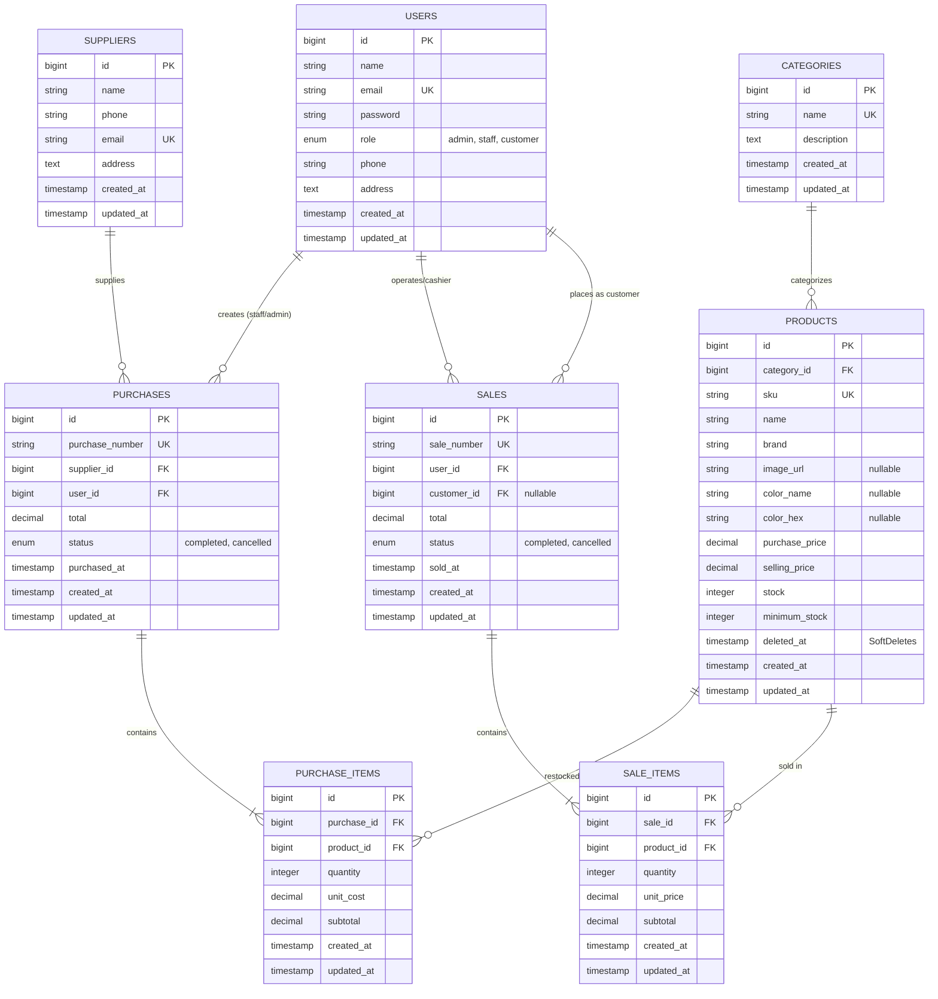

# ElectroMart - Inventory & Sales Management System

[](https://laravel.com)
[](https://www.php.net)
[](https://www.apachefriends.org)
[](https://phpunit.de)
[](LICENSE)

Proyek Ujian Tengah Semester (UTS) Mata Kuliah **Pemrograman Web**.  
Aplikasi sistem informasi pengelolaan persediaan barang (inventaris) dan transaksi penjualan terintegrasi bertema **Toko & Distribusi Perangkat Elektronik** (*ElectroMart*), dibangun menggunakan arsitektur modern **Laravel 12**, **MySQL (XAMPP)**, dan **Bootstrap 5**.

---

## 📌 Daftar Isi
- [Tentang Proyek & Fitur Utama](#-tentang-proyek--fitur-utama)
- [Hak Akses Pengguna (3 Role)](#-hak-akses-pengguna-3-role)
- [Spesifikasi & Persyaratan Sistem](#-spesifikasi--persyaratan-sistem)
- [Panduan Instalasi & Konfigurasi (Reproducible Setup)](#-panduan-instalasi--konfigurasi-reproducible-setup)
- [Akun Demo Pengujian](#-akun-demo-pengujian)
- [Entity Relationship Diagram (ERD) & Relasi Database](#-entity-relationship-diagram-erd--relasi-database)
- [Automated Feature Tests (8 Skenario Wajib UTS)](#-automated-feature-tests-8-skenario-wajib-uts)
- [Batasan Sistem (Known Limitations)](#-batasan-sistem-known-limitations)

---

## 🚀 Tentang Proyek & Fitur Utama

**ElectroMart** dirancang untuk menjawab kebutuhan toko ritel dan distributor elektronik dalam mengotomatisasi pencatatan stok barang, restock dari supplier resmi, kasir kasir (POS), serta alur pemesanan mandiri oleh pelanggan (katalog & checkout).

### Fitur Kunci Aplikasi:
1. **Pembaruan Stok Otomatis & Atomik**:
   - Transaksi **Pembelian (Stock-In)** dari distributor resmi otomatis menambah stok produk.
   - Transaksi **Penjualan (Stock-Out)** via kasir POS maupun checkout online otomatis mengurangi stok produk.
   - Menggunakan `DB::transaction` dan *pessimistic locking* (`Product::lockForUpdate()`) guna menjamin integritas data ACID (*Atomicity, Consistency, Isolation, Durability*) serta mencegah *race condition* dan *overselling*.
2. **Dashboard Agregat Real-Time**:
   - Menghitung omset penjualan hari ini dan bulan ini, biaya pembelian barang masuk, jumlah produk aktif, serta 5 transaksi terakhir langsung dari database.
   - Widget peringatan **Stok Barang Menipis (Low-Stock Alert)** menggunakan query `whereColumn('stock', '<=', 'minimum_stock')` dengan penanda visual status darurat.
3. **Pencarian, Filter Lanjutan, & Pagination**:
   - Pencarian berdasarkan SKU, nama produk, nomor invoice/PO.
   - Filter dinamis berdasarkan kategori, status stok (Tersedia, Stok Rendah, Habis), serta rentang tanggal transaksi (`start_date` s/d `end_date`).
   - Seluruh daftar menggunakan `paginate(10)->withQueryString()` agar kondisi filter tetap bertahan saat berpindah halaman.
4. **Pembatalan Transaksi dengan Rollback Stok (Admin Only)**:
   - Admin dapat membatalkan faktur penjualan (stok dikembalikan) atau pembelian (stok ditarik kembali dengan validasi kecukupan stok).
5. **Isolasi Privasi Pelanggan**:
   - Customer hanya dapat melihat dan mengakses riwayat pesanan serta struk/invoice milik akunnya sendiri.

---

## 👥 Hak Akses Pengguna (3 Role)

Sistem mengamankan seluruh route di sisi server menggunakan *Role-Based Authorization Middleware* (`RoleMiddleware`):

| Role | Hak Akses & Tanggung Jawab |
|---|---|
| 👑 **Admin** | Memiliki akses tertinggi: mengelola Master Data (CRUD Produk, Kategori, Supplier, dan Pengguna), mencatat pembelian & penjualan, membatalkan transaksi dengan mekanisme rollback stok, serta melihat statistik dashboard lengkap. |
| 💼 **Staff** | Bertugas sebagai staf gudang dan kasir: membuka form Kasir POS (`/sales/create`), mencatat penerimaan barang masuk (`/purchases/create`), melihat katalog inventaris dan stok menipis. Ditolak HTTP 403 Forbidden pada aksi mutasi master data dan pembatalan transaksi. |
| 🛍️ **Customer** | Pembeli umum terdaftar: menjelajahi Katalog Produk Elektronik (`/catalog`), melakukan checkout belanja keranjang multi-item mandiri, dan melihat daftar riwayat belanja serta struk resmi miliknya (`/customer/orders`). |

---

## 💻 Spesifikasi & Persyaratan Sistem

Pastikan perangkat Anda memenuhi syarat berikut sebelum instalasi:
- **PHP**: Versi `^8.2` atau lebih baru (ekstensi aktif: `pdo_mysql`, `mbstring`, `openssl`, `tokenizer`, `xml`, `ctype`, `json`, `bcmath`).
- **Composer**: Versi `^2.2` atau lebih baru.
- **MySQL / MariaDB**: MySQL 8.0+ atau MariaDB 10.4+ (tersedia bawaan paket **XAMPP**).
- **Web Server**: Apache XAMPP atau built-in server PHP (`php artisan serve`).
- **Browser Modern**: Google Chrome, Mozilla Firefox, atau Microsoft Edge.

---

## 🛠️ Panduan Instalasi & Konfigurasi (Reproducible Setup)

Ikuti langkah-langkah di bawah ini secara berurutan untuk menjalankan proyek di komputer lokal:

### 1. Clone Repository
Buka terminal (Git Bash / PowerShell), arahkan ke direktori web server (misalnya `C:/xampp/htdocs/`):
```bash
git clone https://github.com/tarimurni/UTS_Integrated_Project_Laravel.git
cd UTS_Integrated_Project_Laravel
```

### 2. Install Dependensi PHP
Jalankan Composer untuk mengunduh seluruh library Laravel 12:
```bash
composer install
```

### 3. Konfigurasi Environment File (`.env`)
Salin file `.env.example` menjadi `.env`:
```bash
cp .env.example .env
```

Buka file `.env` dan pastikan konfigurasi database MySQL XAMPP telah sesuai:
```env
APP_NAME="ElectroMart Inventory & Sales"
APP_ENV=local
APP_KEY=
APP_DEBUG=true
APP_TIMEZONE=Asia/Jakarta
APP_URL=http://localhost:8000

DB_CONNECTION=mysql
DB_HOST=127.0.0.1
DB_PORT=3306
DB_DATABASE=db_uts_elektronik
DB_USERNAME=root
DB_PASSWORD=
```

### 4. Buat Database MySQL
Buka **XAMPP Control Panel**, nyalakan modul **Apache** dan **MySQL**.  
Buka browser dan buka **phpMyAdmin** (`http://localhost/phpmyadmin`) atau jalankan perintah SQL berikut:
```sql
CREATE DATABASE IF NOT EXISTS db_uts_elektronik CHARACTER SET utf8mb4 COLLATE utf8mb4_unicode_ci;
```

### 5. Generate Application Key
Generate kunci enkripsi aplikasi Laravel:
```bash
php artisan key:generate
```

### 6. Jalankan Migrations & Seeders
Eksekusi migrasi skema tabel dan isi data awal (*dummy seed data*) produk elektronik:
```bash
php artisan migrate:fresh --seed
```
*Perintah ini akan membuat 8 tabel relasional dan mengisinya dengan 4 user default, 5 kategori elektronik, 4 supplier, dan 15 produk elektronik realistis (termasuk 4 produk berkondisi stok rendah).*

### 7. Jalankan Server Lokal
Nyalakan local development server Laravel:
```bash
php artisan serve
```
Akses aplikasi melalui browser di alamat: **[http://localhost:8000](http://localhost:8000)**

---

## 🔑 Akun Demo Pengujian

| Role | Nama Pengguna | Email Login | Password | Cara Akses |
| :--- | :--- | :--- | :--- | :--- |
| **Admin** | **Tari Murni** | `admin@electromart.test` | `password123` | Login via `/login` |
| **Staff** | **Ade Afrina** | `staff@electromart.test` | `password123` | Login via `/login` |
| **Customer 1** | **Rahmania** | *(Tanpa Email)* | *(Tanpa Password)* | Langsung di Katalog (`/catalog`) cukup isi Nama & No. HP |
| **Customer 2** | **Alfi Syahri** | *(Tanpa Email)* | *(Tanpa Password)* | Langsung di Katalog (`/catalog`) cukup isi Nama & No. HP |

---

## 📊 Entity Relationship Diagram (ERD) & Relasi Database

### 1. Diagram Relasi Entitas (Mermaid ERD)



### 2. Penjelasan Relasi Eloquent

#### Perbedaan `hasMany()` dan `belongsTo()`:
- **`hasMany()` (Relasi One-to-Many dari sisi Induk / Parent)**:
  - Dideklarasikan pada model induk yang tidak memiliki foreign key.
  - Menandakan bahwa satu record entitas induk dapat memiliki banyak record pada entitas anak.
  - *Contoh*: `Category::hasMany(Product::class)` berarti satu kategori memiliki banyak produk. `Sale::hasMany(SaleItem::class)` berarti satu nomor faktur penjualan memiliki banyak rincian item produk yang dibeli.
- **`belongsTo()` (Relasi Many-to-One dari sisi Anak / Child)**:
  - Dideklarasikan pada model anak yang secara fisik memegang kolom `foreign_key`.
  - Menandakan bahwa record anak tersebut merujuk kembali secara tunggal ke record induknya.
  - *Contoh*: `Product::belongsTo(Category::class)` menyatakan bahwa produk tersebut wajib mengacu ke satu kategori tertentu. `SaleItem::belongsTo(Sale::class)` menyatakan rincian item tersebut merupakan bagian dari satu faktur penjualan.

#### Alasan Penempatan Foreign Key pada Tabel Detail (`purchase_items` & `sale_items`):
1. **Normalisasi Database (Kaidah 1NF & 2NF)**:
   Dalam transaksi riil, sebuah faktur penjualan dapat terdiri dari $1$ hingga $N$ jenis barang yang berbeda kuantitas dan harga satuannya. Jika foreign key diletakkan di tabel header (`sales`), tabel akan mengalami *repeating groups* atau pelanggaran atomisitas nilai atribut.
2. **Fleksibilitas Multi-Item & Perhitungan Subtotal**:
   Dengan menempatkan `sale_id` dan `product_id` di `sale_items`, header transaksi (`sales`) tetap ramping hanya menyimpan ringkasan (*metadata*: nomor faktur, waktu transaksi, status, total bayar), sedangkan rincian dinamis produk tersimpan secara terstruktur di tabel item detail.
3. **Integritas Referensial & Cascading**:
   Penempatan Foreign Key pada tabel anak memungkinkan penerapan constraint `cascadeOnDelete()` atau `restrictOnDelete()` sehingga saat transaksi dibatalkan atau dikelola, hubungan relasional antar produk dan faktur tetap terjaga tanpa adanya *orphan records*.

---

## 🧪 Automated Feature Tests (8 Skenario Wajib UTS)

Aplikasi dilengkapi pengujian otomatis menggunakan PHPUnit yang memverifikasi seluruh business rules sistem. File uji terpusat di `tests/Feature/InventorySalesSystemTest.php` mencakup 8 skenario wajib:

| No | Skenario Pengujian | Hasil Uji | Deskripsi Validasi |
|:---:|---|:---:|---|
| **1** | **Authentication & Guest Protection** | `PASS` | Memastikan *guest* tidak dapat mengakses `/dashboard` (otomatis redirect ke `/login`) dan login dengan password salah ditolak dengan pesan error. |
| **2** | **Product Validation** | `PASS` | Menolak pembuatan produk dengan SKU duplikat, harga beli/jual negatif, atau harga jual lebih rendah dari harga beli (`selling_price >= purchase_price`). |
| **3** | **Purchase Stock-In** | `PASS` | Memastikan transaksi pembelian yang sukses otomatis menambah nilai `stock` produk secara akurat di database. |
| **4** | **Sale Stock-Out** | `PASS` | Memastikan transaksi kasir oleh Staff maupun checkout mandiri oleh Customer otomatis memotong stok produk sesuai kuantitas yang dibeli. |
| **5** | **Insufficient Stock Validation** | `PASS` | Menolak transaksi penjualan yang meminta kuantitas melebihi stok yang tersedia, dan memastikan nilai stok di database tidak berkurang. |
| **6** | **Database Atomicity & Rollback** | `PASS` | Memverifikasi bahwa jika pada transaksi multi-item terdapat 1 item yang stoknya kurang, maka seluruh transaksi di-*rollback* (`sales` tidak tersimpan dan stok item pertama tidak berkurang). |
| **7** | **Role-Based Authorization** | `PASS` | Memastikan pengguna dengan role `staff` dan `customer` menerima respons **HTTP 403 Forbidden** jika mencoba mengakses endpoint khusus `admin` (hapus produk, kelola kategori, kelola user). |
| **8** | **Search, Filter, & Pagination** | `PASS` | Memverifikasi pencarian SKU dan filter kategori mengembalikan data akurat, serta query string tetap dipertahankan pada tautan paginasi (`withQueryString()`). |

### Cara Menjalankan Automated Tests:
```bash
# Menjalankan seluruh test suite (58 tests, 216 assertions)
php artisan test

# Menjalankan khusus 8 skenario wajib UTS
php artisan test --filter=InventorySalesSystemTest
```

---

## ⚠️ Batasan Sistem (Known Limitations)

Sesuai ruang lingkup dan batasan proyek Ujian Tengah Semester (UTS):
1. **Simulasi Pembayaran Langsung (Direct Settlement)**:
   Alur kasir POS dan checkout pelanggan disederhanakan sebagai pembayaran langsung berstatus lunas (`completed`) tanpa integrasi API *Payment Gateway* pihak ketiga (seperti Midtrans, Xendit, atau DOKU).
2. **Tanpa Integrasi API Ekspedisi**:
   Sistem pengiriman produk belum terhubung dengan kalkulator ongkos kirim real-time (seperti RajaOngkir).
3. **Single Warehouse Inventory**:
   Manajemen persediaan barang diasumsikan berada pada satu gudang fisik terpusat (*single-warehouse*), belum mendukung multi-cabang atau pencatatan nomor seri unik (*Serial Number/IMEI*) per unit barang.
4. **Representasi Media Aset**:
   Visual produk pada antarmuka pengguna menggunakan ikon dan badge kategori Bootstrap 5, belum mencakup modul unggah berkas gambar (*multipart file upload*) ke disk penyimpanan lokal/S3.

---

## 📄 Lisensi
Proyek ini dikembangkan untuk keperluan akademik Ujian Tengah Semester Mata Kuliah Pemrograman Web 2 dan dilisensikan di bawah lisensi [MIT](LICENSE).
